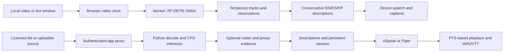

# Touchline — full project report and Claude Code handoff

**Checkpoint: 17 October 2026, Europe/Berlin.** This is the authoritative consolidated handoff. It replaces the earlier version of this file, including its obsolete statements that production verification and publication were pending. Keep the research documents as dated evidence; their older implementation-status statements do not override this report.

## 1. Executive assessment

**Touchline has a working, privately deployed football vision studio and a verified local video-to-neural-speech pipeline. It is not yet a reliable autonomous football commentator ready to sell.**

The application accepts a licensed sample or local video, runs an actual object detector, draws person tracks and ball detections, generates conservative visual descriptions, and dispatches speech/captions. It also implements live browser window capture. A separate Python service adds persistent sessions, CPU inference, offline speech and WAV/VTT exports. The existing operator-assisted production desk remains available.

The important remaining problem is football understanding: reliably recognizing passes, shots and other actions; associating supported player identities; distinguishing replays and referee outcomes; and producing useful, timely play-by-play over a complete match. The verified 16.25-second integration produced **one generic observation**, despite ball candidates in four sampled frames. Working inference and audio transport do not establish compelling commentary.

The **experimental roster/jersey identity component** now has integrated app/service verification and published controls. A delayed-read bug that could attach an old lineup to another match was reproduced and fixed. Real inference with an intentionally synthetic roster preserved unknown players and produced actual Piper audio/exports. Hosted browser inference also passed. Real-football identity precision/coverage and possession inference remain unvalidated. Read [the latest roster/publication evidence](../product/roster-integration-verification-2026-10-17.md).

**Subsequent action-model progress:** a pinned real temporal checkpoint now runs in an isolated CPU research adapter with a bounded causal proposal contract. Paced rolling on the short sample produced no proposals and took 35.28 seconds; a separate full-window control also supplied no foreground winner above threshold. It remains outside customer narration/scoring. The Python suite now passes 36 tests plus 23 subtests. Read [the actual action-model evaluation](../research/action-model-first-evaluation-2026-10-17.md) for exact inputs, runtime and boundaries.

Commercially, the broad idea already exists. We found direct competitors, especially Liat.ai. We have a plausible club-focused positioning hypothesis, but no verified exclusive market gap, paid customer, revenue, or demonstrated willingness to pay.

## 2. User intent, scope and continuity

The user initially explored digital cards/recruiting tools, then explicitly authorized independent product selection and development. The accepted direction is now **video-first football commentary**. The original `universal_digital_card_studio_plan.md` is inspiration/context, not an instruction to build that unrelated product. It remains untracked and must not be rewritten or accidentally committed.

The requested end product should:

- Watch an authorized live game or causally paced recording without requiring every event to be entered by an operator.
- Understand players/actions, use grounded facts, generate commentary, offer language/voice selection, and synchronize playback.
- Eventually support the user's own voice and authorized expressive voices. Current implementation uses free authorized speech; no commentator/celebrity clone was created.
- Use a personalized Premier League-inspired interface and the requested league logos, plus current official information.
- Become usable by real customers and have a credible route to revenue. The user can reach clubs and associations.
- Preserve a detailed handoff so Claude can continue across usage limits.

The user reports permission through a Premier League hackathon colleague and authorizes suitable YouTube/open footage. Proceed within that reported hackathon scope; do not repeatedly ask for the same permission. Organizer delivery credentials/feed URLs and customer-release scope were not supplied. No protected Premier League archive match was downloaded or integrated. Bundled demonstration clips have their own reuse manifests.

A persistent goal is **active** for the full autonomous, customer-usable product. It has not been marked complete. The report and Git repository are the durable continuation record. An active goal does not guarantee background execution or automatic resumption after account/model usage limits; the next agent should resume from this checkpoint when available.

## 3. Repository, deployed release and latest iteration

Repository: **https://github.com/Aminakzyzz/real-suits**, branch **main**.

| Item | Exact state |
|---|---|
| Root project | `/home/aminakziz/projects/real-suits` |
| Earlier verified baseline root commit | `fb4d3381695d58a66bf79693cacf26d339fe625b` |
| New handoff iteration | Experimental identity/roster code, causal action proposal contract, isolated real-checkpoint evaluation and this report; use current Git HEAD rather than resetting to the baseline. |
| Private studio | https://touchline-matchday-desk.socialpony16.chatgpt.site |
| Site ID | `appgprj_6ad2c952011881918cf3fe71b87fdfab` |
| Published platform source | `2cccbaf1aa167a901c57e429149a459b6ccfdcba` |
| Published version | `appgprj_6ad2c952011881918cf3fe71b87fdfab~appgver_49271715232881918fe3e9ae4dadf123` |
| Successful deployment | `appgdep_6ad384c199848191adcb75228b555d10`, returned timestamp `2026-10-17T14:23:16.970361+00:00` |
| Audience | Owner-private custom access; unchanged. This is not a publicly accessible customer launch. |
| Publication checkout | `/tmp/touchline-sites-open`; separate platform Git repository containing the web app. |

Native deployment status confirmed publication. Both the local production Worker and the **actual hosted private studio** passed real browser-model/speech-dispatch/caption checks. Hosted QA used documented origin-scoped Sites service admission; it does not establish ordinary OAuth login or visitor identity. Signed-in local-service workflows were verified separately with loopback-only synthetic trusted identity. The Python service remains local and was not deployed into the Worker. Roster controls are published, with identity still explicitly experimental.

Earlier milestones: `5c237f6` operator-assisted desk; `3d948a4` vision research; `69695f4` studio/service implementation and initial report; `fb4d338` production verification, real neural-audio pipeline and private publication.

## 4. What exists today

| Capability | Implemented behavior | Remaining boundary |
|---|---|---|
| Video inputs | Licensed samples, browser-local uploads, implemented live screen/window capture. | Native OS picker, denial/end/repeated-capture lifecycle still need real-device checks. No authenticated archive/live league feed integration. |
| Browser perception | Real RF-DETR Nano ONNX inference in a worker; person/sports-ball boxes and temporary IoU associations. | Generic COCO detector; crowds/referees can be counted. Tracks are not stable player identities. |
| Narration | Deterministic EN/ES/FR descriptions of visible people/ball observations. | Generic and sparse; no trained action understanding or language-model match reasoning. |
| Browser voices | Available device/system voices, speech dispatch tied to playback. | Device availability varies; no exportable browser voice audio, audible-quality certification or voice cloning. |
| Local service | FastAPI, sequential decoding, CPU ONNX, SQLite sessions, uploads, owner checks and observation logs. | Single executor/prototype lifecycle; no production-scale concurrency, retention policy or full-match soak. |
| Offline speech | Real EN/ES/FR eSpeak WAV; optional English Piper LJ Speech neural voice. | Expressive multilingual neural commentary and pronunciation review remain open. |
| Exports | Service WAV/VTT, browser VTT; manual desk JSON/CSV/SRT/Markdown/PNG. | No complete rendered broadcast/video export pipeline. |
| Player identity, latest iteration | Roster import, configured kit colours, repeated jersey OCR, evidence-bearing name display/introduction. | Experimental local-service path only; synthetic control passed, real-football precision/coverage unmeasured. |
| Football events | Manual desk supports confirmed goals/cards/substitutions and other events with correction. | Automatic passes/shots/goals/possession/rulings are not implemented reliably. Manual events are not hidden CV ground truth. |
| Design/data | Premier League-inspired palette/layout, requested logos, sourced official fixtures/table/news with stale fallback. | Website implementation feeds have no established supported commercial API agreement. |
| Accounts/recovery | Sites identity, owner-scoped manual records and service proxy, local draft recovery, revocable read-only overlay links. | Customer operational controls, monitoring, backups, full service hosting and billing remain unfinished. |

No foundation model was trained. No paid model API is required for the implemented demo.

## 5. Architecture and ownership boundaries



The complete target architecture still needs replay classification, football-specific action recognition, independent evidence/match-state management and a better speaking scheduler between perception and narration. Keep observations, proposed actions, accepted incidents and wording separate. A detected ball is not proof of a pass, a named possessor, a goal or a referee decision.

| Path | Responsibility |
|---|---|
| `apps/touchline/app/page.tsx` | Vision studio at `/`. |
| `apps/touchline/components/vision-studio.tsx` | Source/engine/language/voice settings, capture, playback, overlays, commentary, exports, league panels and new roster controls. |
| `apps/touchline/lib/browser-vision.ts` | Causal video sampling, worker RPC, IoU associations, description policy and cancellation. |
| `apps/touchline/lib/browser-detector.worker.ts` | Actual pinned ONNX inference. |
| `apps/touchline/lib/vision.ts` | Transport types/API helper; latest identity/settings additions. |
| `apps/touchline/lib/roster.ts` | New validated extraction of roster fields; excludes saved events, scores and player facts. |
| `apps/touchline/app/api/vision/[...path]/route.ts` | Signed-in, allowlisted same-origin service proxy; injects owner identity. |
| `apps/touchline/app/desk/page.tsx`, `lib/match.ts` | Existing producer desk and confirmed-event model. |
| `apps/touchline/lib/league.ts`, `app/api/league/route.ts` | Official context discovery, validation, normalization, cache and dated fallback. |
| `services/vision/touchline_vision/perception.py` | Native detector, simple causal IoU tracking, histogram cut reset. |
| `services/vision/touchline_vision/identity.py` | New experimental kit/jersey/roster evidence resolver. |
| `services/vision/touchline_vision/actions.py` | New bounded temporal proposal contract; not enabled in customer inference. |
| `services/vision/research`, `scripts/evaluate_action_checkpoint.py` | Isolated CPU research model adapter and reproducible actual-checkpoint evaluation. |
| `services/vision/touchline_vision/narration.py` | Observation descriptions; latest evidence-gated player introduction. |
| `services/vision/touchline_vision/service.py` | SQLite-backed session lifecycle, paced processing, ownership, media/audio/caption API. |
| `services/vision/touchline_vision/speech.py`, `neural_speech.py` | eSpeak and optional pinned Piper audio adapters. |
| `services/vision/scripts/verify_pipeline.py` | Repeatable real-model, paced neural-audio integration verifier. |
| `apps/touchline/tests/production-smoke.mjs` | Actual production Worker studio/desk smoke, including real model loading. |
| `CLAUDE.md` | Short continuation entry point. |

The service exposes `/health`, `/sources` GET/POST, `/sessions` POST, session GET/DELETE, and session media/audio/caption/WAV endpoints. The app prefixes these with `/api/vision/`. Session settings include source, language, voice, sample cadence, pacing, duration and optional roster.

The Worker is not a Python/CUDA/FFmpeg host. A customer's browser cannot reach a local Python service through the deployed Worker's loopback address. Remote service mode needs separately hosted inference and server-side `TOUCHLINE_VISION_URL` plus matching `TOUCHLINE_SERVICE_TOKEN`. No paid infrastructure was provisioned.

## 6. Models, media, voices and latest identity work

### Shipped detector

- Publisher/model: [onnx-community/rfdetr_nano-ONNX](https://huggingface.co/onnx-community/rfdetr_nano-ONNX).
- Revision: `eae21cee0687a91bcf9fa071605c48d7705d2d91`.
- File: `onnx/model_quantized.onnx`, approximately 28 MB; publisher metadata Apache-2.0.
- Input: RGB CHW 384×384 floats in 0–1. Outputs: 300 normalized boxes, 91-class logits; person index 1 and sports-ball index 37.
- Browser ONNX Runtime Web 1.30.0; native ONNX Runtime 1.31.0. Model/runtime pins are explicit. First browser use still requires internet; full offline packaging/integrity hardening is unfinished.

Two football-specific detector alternatives were evaluated separately: `acatorcini/yolov9-soccer-ball` and `Dura-S/reco-yolo26s-football`. Neither was integrated. Their AGPL-labelled artifacts must be evaluated on their own terms.

### Bundled footage

The current default is **Inter–Ajax U19, 26 March 2012**, by zilupe: 16.250 seconds, 1280×720, muted H.264, 2,778,850 bytes. SHA-256: `9ef107eaf7b39c61f6511046a37f13de175b2f782c3ee4224c3118b018902b6c`.

The [original Flickr source](https://www.flickr.com/photos/zilupe/7018838149/) links CC BY 2.0 in its JSON-LD; the [Commons description](https://commons.wikimedia.org/wiki/File:Next_Generation._U19._Inter_vs_Ajax._Ajax_goal..webm) provides provenance. Preserve `public/demo/source.json` and `inter-ajax-source.json`. The title's goal label is metadata, **not model evidence**.

Alternatives include a 30-second Ajax–Utrecht 2024 excerpt under CC BY 3.0 and a roughly 17-second Latvia–Gibraltar 2026 clip under CC0. These are short, imperfect camera samples, not representative full-match benchmarks. No Premier League archive recording is bundled. Full provenance is in `docs/research/media-and-brand-sources-2026-10-17.md`.

### Free speech

Browser voices are immediate and device-dependent. eSpeak NG provides actual EN/ES/FR WAV generation; it sounds synthetic. Optional `piper-en` uses the English LJ Speech medium voice, approximately 63.5 MB, with pinned revision and SHA-256 verification. Publisher metadata identifies the model as MIT and LJ Speech data as public domain; the Piper runtime is GPL. See `docs/product/free-speech.md` for exact artifact terms and commands.

Lessac was deliberately excluded after its individual dataset terms proved unsuitable for commercial speech-product development. Own-voice cloning, licensed commentator identity and expressive neural Spanish/French remain future work. Original delivery presets are feasible without copying a famous person's voice. Do not mistake a match-video permission for a voice license.

### Experimental identity iteration

The new resolver uses a supplied match roster and selected visible kit colours. It does not use face recognition or guess names from famous-player knowledge. It requires at least three agreeing `(team, jersey number)` readings, separated in time, spanning at least 1.2 seconds. It rejects weak/ambiguous evidence, conflicting fresh readings, expired evidence, duplicate simultaneous identities and camera/time discontinuities.

OCR is optional local Tesseract. Small original crops remain unknown; enlarging a tiny crop does not establish legibility. At most two player crops are OCR-processed per sampled frame. A name is attached only with a current accepted reading, rather than carried through unreadable frames by a fragile temporary track. The narrator can introduce a supported visible player; it never turns this identity into possession or a goal claim.

The frontend imports only lineup/kit fields from roster JSON or a producer-desk backup. Stored events, scores and facts are stripped to prevent future-outcome leakage. Roster state clears on source/engine changes. The UI labels the feature experimental and offers kit-colour adjustment.

**Evidence boundary:** unit/component tests passed, including actual Tesseract on a synthetic readable jersey. That validates the plumbing, not real-football identity precision. The current strict kit/crop gates may have low coverage; thresholds are heuristics and OCR confidence is not calibrated identity probability. UI integration, production checks and private publication now passed. Real-football labelled evaluation remains open; generic person detections may include spectators/officials, so kit/jersey evidence still needs on-pitch eligibility and negative-example evaluation.

## 7. Research and competitive assessment

The deeper review is in `docs/research/live-football-vision-2026-10-17.md`; repository/model metadata snapshots and exact revisions are retained alongside it. Its opening implementation-status paragraph is historical, preceding the build.

The linked [YOLO/OpenCV tutorial](https://www.youtube.com/watch?v=neBZ6huolkg) and [associated code](https://github.com/abdullahtarek/football_analysis) informed component decomposition. The code was inspected; the video was not watched/transcribed. Its ball interpolation/backfill can use future observations, and foot-proximity assignment is only a possession heuristic. Neither is a ready live commentator or a basis for a causal accuracy claim.

### Relevant state of the art

| Work | Why it matters | Adoption status / limitation |
|---|---|---|
| [SoccerNet Game State Reconstruction](https://github.com/SoccerNet/sn-gamestate) | Strong modular reference for geometry, teams, roles and jersey identity. | Not integrated; GPL code plus separate weights/data terms; audit offline aggregation before online use. |
| [SoccerMaster](https://github.com/haolinyang-hlyang/SoccerMaster) | Football-specific representation learning and multi-component pipeline. | Not integrated; not a lightweight single checkpoint; component/data rights and runtime need review. |
| [FOOTPASS](https://github.com/JeremieOchin/FOOTPASS) | Player-centric action taxonomy and tactical/track-based methods. | Supplied tracking inputs are not raw-video inference. README/license declarations conflict; no commercial clearance inferred. |
| [PAVE](https://arxiv.org/html/2607.07320v1) / [ME-DST](https://arxiv.org/html/2608.01696v1) | Recent action-attribution methods worth comparing. | Published macro/micro F1, splits and inputs differ; not directly comparable and not commentary accuracy. No ready winner deployment was established. |
| [StreamSoccer](https://arxiv.org/html/2608.19723v1) | Event memory and speak/silence scheduling are directly useful architectural ideas. | Main evaluations use reference/label assistance; not proof of fully autonomous raw-video performance. No installed release. |
| [MatchTime](https://aclanthology.org/2024.emnlp-main.99.pdf) / [TimeSoccer](https://github.com/vpx-ecnu/TimeSoccer) | Temporal alignment and history-aware commentary research. | Training/evaluation resources, not demonstrated causal live deployment here. |
| [Qwen3-TTS](https://github.com/QwenLM/Qwen3-TTS) / [Chatterbox](https://github.com/resemble-ai/chatterbox) | Possible own-voice and expressive multilingual extensions. | Researched, not installed/integrated/benchmarked. Exact model variants and terms matter. |

**Newest actionable model lead:** the [OpenSportsLab 2025 E2E checkpoint](https://huggingface.co/OpenSportsLab/OSL-loc-snbas-2025-e2e) is accessible without a gate, revision `54e24a663a5a0ed057ef12cf16d9460d270ddc6e`, with a 152,081,691-byte `model.pt`. Its card lists twelve ball-action classes and publisher-reported tight/loose mAP 47.98/58.35. These results were not reproduced. The artifact is AGPL-labelled; its card requests contact for proprietary/commercial deployment. Its configuration uses temporal clips and a DALI backend, and has now been executed in an isolated reconstructed CPU adapter; its benchmark was not reproduced. Preprocessing parity, useful domain performance, runtime and deployment conditions still require review before integration. Code, weight and SoccerNet training-data conditions remain separate. See `docs/research/action-checkpoint-availability-2026-10-17.json`.

Actual short-clip, dense-sampling and full-window controls now exist in `docs/research/action-model-first-evaluation-2026-10-17.md`; none established useful autonomous play-by-play. The model remains an executable research baseline, not a proven drop-in solution. Do not install a large CUDA stack indiscriminately: this machine has about 15 GiB RAM, no established usable CUDA GPU, and was under memory pressure during development.

### Competitors and actual gap assessment

| Competitor | Publicly advertised offer | What our research does not establish |
|---|---|---|
| [Liat.ai](https://liat.ai/) | Direct single-feed CV football commentary, 20+ languages, 30+ event types, selectable voice/tone, tracking, highlights, statistics/context and sponsors. Free pilot contact. | Independent accuracy, latency, deployment terms and comparable small-club tariff. We cannot claim these features are missing. |
| [CAMB.AI](https://www.camb.ai/blog-post/2026-trophee-des-champions-to-become-first-european-football-match-with-ai-dubbed-commentary) | Announced live AI dubbing/localization of existing football commentary; broader generative commentary marketing. | Dubbing an existing commentator is distinct from inferring every event from raw video. Comparable commercial offer not trialled. |
| [Spiideo Play](https://www.spiideo.com/spiideo-play/) | Automated production, camera ecosystem, third-party ingestion, graphics, replays, commentary workflows and distribution. | Exact autonomous narration package, hardware constraints and total comparable price. |
| [Pro Talk](https://protalk.studio/) | Advertises AI commentary, tracking, graphics and smartphone capture. | Inspected page was coming-soon/waitlist; operational availability unverified. |
| [OBSFootball](https://obsfootball.com/pricing/) / [ScoreLayer](https://www.scorelayer.live/pricing) | Low-cost football controls/overlays and streaming workflows. | Adjacent substitutes, not proof of automatic CV play-by-play. Hands-on competitor trials not completed. |

These are vendor claims and research snapshots, not independently verified product benchmarks. Public pages do not establish negative claims about missing competitor features.

The opportunity to test is a **club-focused, bring-your-own-feed commentary workflow** with convenient setup, club-controlled vocabulary, transparent uncertainty/corrections, accessible pricing and a sensible local/hosted choice. That is a positioning hypothesis. It is not a demonstrated moat, and customization alone does not distinguish us from Liat's advertised offer.

A credible revenue experiment is a permitted club rehearsal followed by a concrete paid-repeat decision. Compare our result with the club's volunteer, no commentary and a competitor's actual pilot offer. Measure useful commentary, manual interventions, total match cost and support effort. No customer interviews, paid commitments or revenue have been recorded.

The earlier overlay-era €9/match or €19–29/month suggestions are unvalidated hypotheses and should not be reused as an autonomous-inference price. Calculate compute, media egress/storage, speech, support and payment costs first. Per-language audio adds costs even when perception is shared. No forecast is justified yet.

## 8. Verification: exactly what passed

### Published baseline, before the newest identity iteration

- **20 Python tests and 23 subtests** passed; actual speech and optional installed-model integration were exercised.
- **16 TypeScript/domain tests** and type checking passed.
- **Six existing Chrome end-to-end workflows** passed, primarily for the manual desk: persistence/edit/export, conflicts, owner isolation, overlay revocation, mobile layout and speech/video dispatch.
- The final web app built and ran as an actual local production Worker. Chrome loaded the real model, produced detection overlays (nine boxes in the saved smoke run), dispatched narration, downloaded nonempty WebVTT and reported no page errors. `/desk` still accepted a confirmed goal; unsigned protected APIs returned 401.
- Native private publication succeeded for the exact platform source listed above.

### Complete real-model local integration

The complete licensed **16.25-second** sample ran at paced 1× through the authenticated local app proxy, real RF-DETR CPU and actual `piper-en` synthesis:

| Measurement | Observed result |
|---|---|
| Sampled frames | 17 |
| Frames with ball candidates | 4 |
| Generated observations / neural speech segments | 1 / 1 |
| Detector inference p50 / p95 | 241.7 / 328.9 ms on this machine in that run |
| Audio format | 22,050 Hz, mono PCM WAV |
| Export length | 16.249977 seconds, within one PCM sample of source duration |
| Captions | Nonempty WebVTT |
| Causality timestamps | Equal source/evidence PTS for every sampled observation |

These are short-clip integration measurements. They do not measure named-player precision, football-action recall, useful commentary density, full-match capacity or audible professional quality. Speech dispatch instrumentation does not establish how browser voices sound.

In the separate detector comparison, each of RF-DETR, YOLOv9 and YOLO26 produced candidates in four of seventeen sampled frames. Mean native inference was approximately 283, 1,015 and 2,124 ms respectively. There is no complete manual ball ground truth: **candidate coverage is not precision or recall**.

### Newest identity checkpoint: rechecked for this handoff

- **26 Python tests and 23 subtests passed**, no skips in the observed run: `26 passed, 23 subtests passed in 22.45s`.
- **18 TypeScript/domain tests passed**, including two new roster-validation/leakage tests; type checking passed.
- The six new identity tests cover repeated/independent evidence, conflicts and gaps, team/roster uniqueness, unreadable/ambiguous abstention, actual Tesseract synthetic control, cut/unreadable-frame reset and EN/ES/FR evidence-only introduction.
- **Subsequent integration verification:** all eight Chrome workflows passed, including two roster/service workflows with actual inference/Piper; both also passed against the packaged local production Worker. A delayed-file/source-switch regression was reproduced and fixed. Current production and hosted browser smokes passed, and controls were published privately. These checks establish plumbing/unknown fallback, not real named-player accuracy.

### Latest roster/publication checks

Type checking, 18 domain tests and eight development Chrome workflows passed. Two additional local production executions of the roster workflows used loopback-only synthetic trusted identity. Actual hosted QA used Sites service admission and captured nine real detection boxes, narration dispatch, VTT and no page errors. The local service processed 15 roster-enabled frames, kept unsupported players unnamed and produced actual Piper audio/exports. Setup now waits for client initialization, stale roster reads cannot cross source/engine changes, and kit collisions are rejected before creating sessions. See `docs/product/roster-integration-verification-2026-10-17.md` and its evidence JSON. Ordinary hosted OAuth login, smooth continuous overlays and real-football identity precision are still open.

### Subsequent actual action-model checks

Ten new temporal contract tests passed; the full Python suite now reports **36 passed, 23 subtests passed**. Actual checkpoint loading and four research diagnostics completed. The paced rolling path returned zero proposals and lagged the short source; the unpadded longer-footage control did not produce a foreground winner above the default threshold. This is useful negative evidence, not successful football understanding. No frontend files were changed by this action-model iteration. Read `docs/research/action-model-first-evaluation-2026-10-17.md` and its linked raw evidence before choosing the next model/data step.

Detailed baseline evidence: `docs/product/vision-verification-2026-10-17.md` and `vision-validation-evidence-2026-10-17.json`. Current new tests are source evidence, not an accuracy benchmark.

## 9. Startup and reproduction

### Environment

Use Node **22.13+** and npm. The optional service requires Python **3.11/3.12**; system Python here is 3.14, so use the existing `.venv` or select 3.11 with `uv`. FFmpeg/FFprobe, eSpeak NG and optional Tesseract English are available on this machine. Do not assume a CUDA GPU. Do not recreate existing virtual environments or delete `.wrangler/state` to make a test pass.

Models, voices, uploaded media, SQLite runtime data, screenshots and virtual environments are ignored; another machine must install/download these separately. No credentials belong in Git. Existing local servers may be running on 5173/8788; check before starting duplicates.

### Web application

```sh
cd /home/aminakziz/projects/real-suits/apps/touchline
npm ci
npm run dev
```

Open the printed URL, usually `http://127.0.0.1:5173`. `/` is the vision studio; `/desk` is the producer desk. Browser mode needs no Python service or paid key. If service-mode authentication is needed locally, visit `/signin-with-chatgpt?return_to=/`; portable local development uses the existing loopback simulated sign-in, hosted deployment uses Sites identity.

For a **fresh** local database only, follow root `README.md`: build and apply `drizzle/0000_classy_toro.sql` with the existing Wrangler configuration/persistence directory. Do not replay a migration already applied to this workspace.

### Optional local service

```sh
cd /home/aminakziz/projects/real-suits/services/vision
# Create only if an appropriate .venv does not already exist:
uv venv --python 3.11
uv pip install --python .venv/bin/python -e '.[test,neural]'
.venv/bin/python -m touchline_vision.cli setup
.venv/bin/python -m touchline_vision.neural_speech setup
.venv/bin/python -m touchline_vision.cli serve --port 8788
```

Select **Local service** in the studio; choose `piper-en`/LJ Speech neural for English or eSpeak for Spanish/French. Restart after source updates: the service imports bundled source manifests at startup, including reconciliation of the replaced default sample.

Latest identity JSON shape:

```json
{
  "home": {"name": "Blue Club", "color": "#0000ff", "players": [{"id": "home-27", "name": "Demo Player", "number": 27}]},
  "away": {"name": "Red Club", "color": "#ff0000", "players": [{"id": "away-9", "name": "Other Player", "number": 9}]}
}
```

This is illustrative synthetic roster data, not the correct roster for bundled footage. Import an actual match-valid roster when evaluating identity, and select visible kit colours rather than assuming the club's brand colour.

### Checks

```sh
# apps/touchline
npm run typecheck
node --experimental-strip-types --test tests/domain.test.ts tests/league.test.ts tests/roster.test.ts
npm run test:e2e
npm run build
npm run start -- --port 5174
# In another terminal, while production Worker is running:
node tests/production-smoke.mjs

# services/vision
PYTHONPATH=. .venv/bin/python -m pytest -q
# With app and service running; actual model/voice files must be installed:
.venv/bin/python scripts/verify_pipeline.py --app-proxy --base-url http://127.0.0.1:5173
```

Playwright expects dev server 5173 and Chrome. The production smoke defaults to 5174; override with `TOUCHLINE_TEST_URL`. The real pipeline verifier writes ignored `.runtime/verification` artifacts and excludes request credentials. `npm test` alone currently runs only the original domain suite; use the explicit three-file command above to include league/roster tests.

## 10. Integration traps and operational gaps

1. **Preserve the working browser worker loading combination:** Vite `?worker` constructor import, static external ESM import of pinned ONNX Runtime, and `worker: { format: 'es' as const }` in `vite.config.ts`. Prior alternatives produced `file://` worker URLs or injected `window`-based dev/HMR code into workers. Verify the real Vinext app in dev and production if changing this.
2. **Cloudflare redirects:** Fetch rejects `redirect:'error'` in this environment. The proxy uses `manual` and rejects unexpected redirects. Do not regress it.
3. **Data freshness:** league context discovers season/matchweek from the official `/en` homepage, validates upstream JSON and uses a clearly dated fallback. Fixture and standings matchweeks may differ. Do not feed archive commentary future results from current league panels.
4. **Weak perception:** small balls, occlusion, camera pans, crowds and replays remain difficult. Current tracking is simple greedy IoU, not ByteTrack or stable ReID. Cut reset is not replay detection.
5. **Weak narration:** the eight-second cooldown suppresses transient observations. Replace it with event priority/lifecycle and bounded speaking decisions; merely making generic lines more frequent is insufficient.
6. **Audio/lifecycle:** no sustained seek/reconnect/underflow/half-time/provider-failure validation. Native Piper inference has no hard interruption. Long-match queue/memory/retention behavior and service crash recovery need review.
7. **Deployment:** preserve owner-private audience. For website publication use the installed Sites skill and native tools; open the source checkout, synchronize app source while preserving its `.git`/manifest, build/package and deploy the returned immutable source. Refresh credentials through the tool; never copy prior credentials into docs or shell arguments. Root GitHub source and platform source have different hashes.
8. **No hidden oracle inputs:** never infer a goal from a filename, commentator audio, final score, prewritten manual event log or future frames and call it autonomous live CV. Temporal models may emit delayed events only if evidence-availability time and delay are explicit.

## 11. Prioritized continuation plan for Claude

**P0 — validate actual football identity and player eligibility.** The roster UI/service/plumbing/publication checks are complete; read the latest evidence rather than repeating them without changes. Evaluate readable numbers, competing identities, substitutions, camera cuts and spectators/officials with independent labels. Add on-pitch eligibility before treating generic person boxes as players. Preserve unknown actors and measure precision plus coverage; synthetic positive/unknown controls do not prove football accuracy.

**P1 — implement useful action understanding, the main product bottleneck.** A bounded `actions.py` proposal interface and actual isolated OpenSportsLab research adapter now exist. Read the negative/limited evaluation first. Review preprocessing parity and evaluate permitted broadcast-quality footage with independent labels before choosing adaptation or replacement; the current spectator clips did not establish usable actions. Keep model guesses separate from accepted incidents. If unsuitable, keep it a research baseline and implement/train a permitted alternative. Begin with a small useful taxonomy; measure actual inferred inputs, not supplied tactical/oracle tracks. A useful action can remain anonymous when actor identity is unsupported.

**P1 — build evidence/state and better commentary scheduling.** Store source event time, latest evidence time, decision time, confidence per event/team/actor/outcome and provenance. Handle candidate → confirmed → corrected incidents, replay deduplication and score changes separately. Ground wording in accepted facts, keep deterministic fallback and prioritize meaningful play over repeated counts. Translation should use the same structured facts, not invent statistics.

**P1 — create a real evaluation set.** Use permitted contiguous footage with routine play, camera cuts, close-ups, occlusions, replays, near misses and actual rule outcomes. Split by whole match and hold out camera/club conditions. Label ball visibility, actions, identities and ambiguity. Report precision and coverage separately; silence alone cannot pass usefulness review.

**P2 — harden and pilot.** Complete screen-capture lifecycle tests, full-match soak, cancellation/backpressure, restart/recovery, deletion/retention, concurrency and owner isolation. Measure timing and actual cost. Then run a permitted club rehearsal, observe usability and request a concrete paid-repeat decision. Add billing/paid hosting only after a real offer and authorization; neither is needed to prove the current technical hypothesis.

### Parallel work breakdown

Claude can divide work along these boundaries without multiple agents editing the same files:

| Workstream | Owns | Deliverable |
|---|---|---|
| Integrator | Studio/proxy, verification, deployment, status docs | Review latest identity UI, exact-source production check, reproducible demo and immutable release record. |
| CV/actions | New `actions.py`, its adapter/config/tests | Causal proposals with evidence timestamps and held-out action metrics; no UI edits. |
| Identity/evaluation | `identity.py`, identity tests, labelled evaluation manifest | Real-football named-actor precision/coverage; unknown handling, kit/jersey/cut/substitution failure analysis. |
| Narrative/audio/reliability | Explicitly agreed narration/speech or session-lifecycle files | Useful speaking policy, pronunciation/timing, bounded queues and complete-match resilience. |

Use branches/worktrees when agents run simultaneously. Claude CLI was not installed here; prior parallel workers were Codex agents and reached usage limits. Do not assume a Claude process or an unfinished background review is running.

### Completion evidence, not promises

Proposed gates: a contiguous 10–15-minute permitted, paced autonomous demo with useful actions and no hidden event log; then full-match operation. Measure actor precision **and** coverage, per-class action precision/recall, false goals and replay duplication, source/evidence/decision/first-audio times, playback alignment, resource usage and cost. Suggested pilot aspirations include ≥98% precision among spoken names and ±0.5-second alignment to scheduled buffered playback; neither has been achieved or validated. Require explicit goal/no-goal opportunities and correction cases rather than a vacuous zero-error test. Finish with a real permitted club rehearsal and paid-repeat evidence.

## 12. Paste this into Claude Code

> Continue Touchline in `/home/aminakziz/projects/real-suits` on the current branch. Read `CLAUDE.md`, then `docs/handoffs/BUILD_REPORT_AND_CLAUDE_HANDOFF_2026-10-17.md`. The verified private deployment has real generic CV and description narration; a separate complete short-clip local neural-audio/export pipeline also passed. Roster controls are published and integrated UI/service checks passed, including a fixed stale-read/source-switch regression. Actual hosted browser inference/speech dispatch/captions also passed through origin-scoped Sites service admission, which is not an ordinary OAuth test. Real-football identity precision and player eligibility remain open. Subsequent action-model work adds a bounded causal proposal interface and an isolated executable checkpoint adapter; actual research results remain insufficient for useful commentary. Current Python suite: 36 tests plus 23 subtests; frontend checks: type checking, 18 domain tests, eight development Chrome workflows and two production roster workflows passed. Preserve the user's original untracked plan, media attribution, reported Premier League hackathon scope and owner-private audience. Continue with actual football identity/player eligibility, causal action understanding, evidence-grounded commentary scheduling and full-match reliability; preserve the verified release and do not redo completed checks without relevant changes. Read the actual OpenSportsLab checkpoint evaluation and reusable research runner before further model work; do not confuse its executed research baseline with a usable or commercially cleared action layer. Use free authorized speech. Do not present generic descriptions, synthetic OCR controls, a manual event log or a successful deployment as completed autonomous football commentary. Keep the full customer-product goal active until its actual acceptance evidence exists. Update the report with exact results and next steps.

## 13. Supporting records

- `docs/product/roster-integration-verification-2026-10-17.md` and `roster-validation-evidence-2026-10-17.json`: latest UI regression fixes, real service integration, hosted QA and private publication.
- `docs/product/vision-verification-2026-10-17.md` and `vision-validation-evidence-2026-10-17.json`: published baseline and actual integration evidence.
- `docs/research/live-football-vision-2026-10-17.md`: detailed technical research, sources, dataset/model boundaries and proposed architecture.
- `docs/research/action-model-first-evaluation-2026-10-17.md` and `docs/product/action-model-evidence-2026-10-17.json`: actual checkpoint experiments and next model/data decision.
- `services/vision/research/README.md`: isolated CPU setup, exact hashes and executable evaluation commands.
- `docs/research/action-checkpoint-availability-2026-10-17.json`: accessible action checkpoint revisions/file sizes and updated execution state.
- `docs/research/source-snapshot-2026-10-17.json`: inspected repository/model provenance.
- `docs/research/initial-detector-comparison-2026-10-17.json`: limited, non-ground-truth detector comparison.
- `docs/research/media-and-brand-sources-2026-10-17.md`: actual footage, official design/data sources and attribution.
- `docs/product/free-speech.md`, `services/vision/README.md`: voice/runtime setup and exact provenance.
- `docs/product/touchline-operator-guide.md`: existing manual desk operation.
- `docs/research/product-pivot-2026-10-17.md`: historical idea comparison and manual-first hypothesis, superseded where the user requested autonomy.
- `docs/research/market-research-2026-10-17.md`, `competitor-validation-scorecard.md`, `docs/product/proposed-pilot-and-acceptance.md`: historical digital-card/recruiting research; not current football implementation instructions.

The immediate engineering handoff is complete. The autonomous, reliable, revenue-generating customer product remains the active objective.
