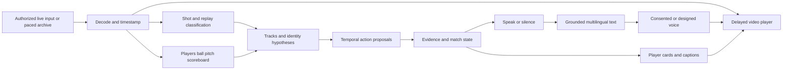

# Live football vision and commentary — research decision

Research date: 17 October 2026. Scope: a technical and commercial research milestone for Claude to continue implementation. **The autonomous pipeline described here has not been implemented or benchmarked in this repository.** The existing Touchline Desk is a deployed, operator-assisted application.

## Decision

Build a video-first pipeline with separate perception, event state, narration and synchronized playback. Use pretrained components, then fine-tune the weak football-specific components on authorized footage. Do not start by training a foundation model or assume that replacing YOLOv8 with a newer detector solves commentary.

For the hackathon, prioritize Premier League footage covered by the permission the user reported during this session. Reproduce an archive clip as a **paced, causal stream**, then connect the same service to a permitted live input. An archive replay is a useful live-pipeline test; it is not evidence that a live Premier League source has been integrated.

Recommended starting stack, subject to measured results:

| Layer | First implementation | Reason and remaining uncertainty |
|---|---|---|
| Media | FFmpeg/PyAV, timestamped frames, bounded ring buffer | One clock for inference, captions and audio; no whole-match loading. |
| Detection | RF-DETR Small, compare Nano/Medium; football fine-tuning | A commercially permissive detector family is available. Test the ball separately: COCO accuracy does not establish football accuracy. |
| Tracking | ByteTrack; shot-boundary reset; conservative re-identification | Low-complexity baseline with explicit lost-track states. A track ID is not a player identity. |
| Identity and match context | Kit classifier, jersey OCR with temporal voting, supplied rosters; scoreboard OCR | Names require evidence, not a language model's familiarity with famous players. |
| Action understanding | Past-only temporal clips plus ball/player geometry; Qwen3-VL candidate verifier; optional FOOTPASS research adapter | The principal engineering risk. A general VLM is an experimental event proposer, not an authoritative referee. |
| Commentary | Structured event memory, approved facts, constrained writing and deterministic fallback | Maintain facts independently from wording. Decide when to speak and when to remain silent. |
| Speech | Benchmark Qwen3-TTS 0.6B/1.7B Base for own voice; VoiceDesign for original styles; Chatterbox alternative | Choose by real pronunciation, expression, latency and language tests, not a demo's first-packet claim. |
| Viewing | Owned/authorized video player, adjustable initial delay, PTS-scheduled audio and captions | Synchronization is part of the product, not a post-processing detail. |

The detector and speech choices have publisher licensing evidence below. The event layer still requires implementation and evaluation. There is no verified drop-in, commercially cleared checkpoint in this review that delivers the complete raw-video-to-named-live-commentary experience.

## Authorization and media inputs

The user states that a colleague granted permission because they are participating in a Premier League hackathon, and that YouTube videos can also be used. Treat that statement as authorization to proceed with the hackathon prototype. Do not repeatedly request permission or treat the ordinary public archive terms as cancelling the reported hackathon arrangement. The exact grant, duration, source-delivery mechanism and customer-release scope have not been supplied.

Keep a small source manifest: source ID, origin, permission basis (`user-reported Premier League hackathon permission`, for example), approved uses, expiry if known, and whether public demo redistribution is covered. Unknown scope stays unknown; it should not become a fabricated commercial license.

The ordinary [Premier League website terms](https://www.premierleague.com/en/terms-and-conditions) reserve rights, allow limited private use, and require approval for other reuse, commercial use and framing/deep-linking. These explain why an ordinary free viewing account alone would be insufficient; the user's separate hackathon permission is the relevant additional context. The supplied archive route returned 404 to a public fetch during research; no authenticated account, playable match, feed URL or archive-specific agreement was inspected. This does not disprove the user's account access.

For YouTube-origin material, prefer a source file or live feed supplied by the organizer/rights holder. A YouTube watch URL is not directly decodable media. [YouTube API developer policies](https://developers.google.com/youtube/terms/developer-policies) restrict downloading/caching audiovisual content and applying alternate audio through API-service player manipulation. Consequently, an embedded YouTube player plus replacement narration is not the default integration. Use authorized original media in our player; an external-player companion requires its own platform-compatible design. No stream extraction, credential sharing or protection bypass was performed.

Hackathon footage permission, third-party model licenses, dataset conditions, voice permissions and later customer distribution are separate questions. Resolve each within its actual scope rather than treating one permission as covering every artifact.

## What the linked tutorial actually contributes

The [linked video](https://www.youtube.com/watch?v=neBZ6huolkg) is titled *Build an AI/ML Football Analysis system with YOLO, OpenCV, and Python*. Its associated [Abdullah Tarek repository](https://github.com/abdullahtarek/football_analysis) was inspected directly; this review does not claim to have watched or transcribed the video.

The code combines YOLO detections, ByteTrack, team color classification, camera movement compensation and pitch transformation. It is useful for learning component boundaries. Important implementation limits:

- [Ball interpolation](https://github.com/abdullahtarek/football_analysis/blob/main/trackers/tracker.py) uses interpolation and backward filling, which can use future observations. It is unsuitable as-is for a causal live benchmark.
- [Ball assignment](https://github.com/abdullahtarek/football_analysis/blob/main/player_ball_assigner/player_ball_assigner.py) uses proximity to the player's feet and a 70-pixel threshold. This is a heuristic, not reliable possession or contact recognition.
- Team color and track IDs do not establish roster identity. The code does not supply a complete semantic event/commentary system.

The inspected repository tree has no detected top-level license. A derivative tutorial's license cannot establish permission for the original code, weights or footage. Use it as a reference until those terms are established.

## State of the art: distinguish tasks and evidence

“Best model” is the wrong unit of comparison. Detection, jersey recognition, calibrated tracking, player-centric action spotting, caption generation, speaking decisions and speech synthesis have different inputs and metrics. Offline processing may use future frames or whole-track identity voting. An online implementation must disclose its lookahead and emit only when its evidence has arrived.

| Research/system | What is established by the primary source | Product relevance and boundary |
|---|---|---|
| [SoccerNet Game State Reconstruction / TrackLab](https://github.com/SoccerNet/sn-gamestate) | Modular reconstruction of player positions, roles, teams and jersey numbers, with baseline models and GS-HOTA evaluation. | Best reference for decomposing identity and geometry. Video-wide processing/aggregation needs an online audit. The repository is [GPL-3.0](https://github.com/SoccerNet/sn-gamestate/blob/main/LICENSE); dependency, weight and data terms are separate. |
| [SoccerMaster, CVPR 2026](https://arxiv.org/abs/2512.11016), [implementation](https://github.com/haolinyang-hlyang/SoccerMaster) | Soccer-specific representation learning with released checkpoints and a data pipeline. | Useful research comparison. Its documented pipeline also requires detection, tracking, SAM2, calibration, ReID and jersey models. It is not one lightweight live-commentary checkpoint. |
| [FOOTPASS](https://github.com/JeremieOchin/FOOTPASS) | Eight player-centric ball-action classes; 54 matches and 102,992 events; TAAD, GNN and sequence-transduction baselines. | Closest action taxonomy. Uses tracking/tactical inputs: measure performance with our inferred inputs as well as supplied inputs. Public baseline training code is not proof that a ready pretrained action checkpoint is available. |
| [SoccerNet 2026 PCBAS winner: PAVE](https://arxiv.org/html/2607.07320v1) | Challenge macro F1 58.94 versus baseline 46.41. Matching requires action, team, jersey and timing within ±12 frames; predictions below 0.15 confidence are filtered. Winner uses multiple TAAD/DST variants and fusion. | Substantial progress, still far from error-free attribution. This is not “58.94% accurate commentary.” No reproducible winner checkpoint/license was established here. |
| [ME-DST, August 2026](https://arxiv.org/html/2608.01696v1), [repository](https://github.com/WRF32-10/ME-DST) | Entity-aware temporal/spatial attention, tactical features and fused visual predictions; reports validation **micro F1 0.778**. | A promising action-model design. Micro F1 on validation cannot be ranked directly against PAVE's challenge macro F1. Inspect window causality; the source describes 750-frame DST windows. No ready model weight release or explicit repository license was established. |
| [GameSight, March 2026](https://arxiv.org/abs/2604.00057), [project](https://gamesight2025.github.io/gamesight2025/) | Separates player/entity alignment from knowledge-enhanced commentary and updated match state. | Strong design support for grounding names and statistics before writing. A demo page and paper do not establish a deployable licensed service or continuous raw-video latency. |
| [StreamSoccer, August 2026](https://arxiv.org/html/2608.19723v1) | Event-lifecycle memory, recent/historical context, and a speak-or-silence scheduler built around Qwen3-VL-8B. | Most directly relevant streaming architecture. **Its appendix limits the evidence:** main quality evaluation uses reference anchors, oracle event closure and label-assisted metadata; the free-scheduler audit also uses cached tokens and label assistance. Raw-video throughput is not autonomous commentary accuracy. Reported request p95 is roughly 2.47–3.86 seconds; measured peak VRAM roughly 18 GiB. No public code/weight release was established. Use architecture ideas, not an invented ready checkpoint. |
| [MatchTime / MatchVoice, EMNLP 2024](https://aclanthology.org/2024.emnlp-main.99.pdf) | Addresses temporal video/commentary misalignment and supplies an aligned commentary benchmark. | Helpful supervision/evaluation reference; existing human commentary is a label, not an inference input for a CV-only claim. |
| [TimeSoccer, ACM MM 2025](https://github.com/vpx-ecnu/TimeSoccer) | Long-video, history-aware dense commentary model and training pipeline. | Useful offline comparison. Full-half or reference-timestamp results do not establish causal speaking decisions; inspect inherited licenses and separate video rights. |
| [Vision Agents](https://github.com/getstream/vision-agents) | Apache-2.0 orchestration with video transport and pluggable perception/voice models. | Possible plumbing accelerator. SDK transport latency is not total event-to-audio latency, football accuracy or a substitute for the event ledger. |

This is a targeted review of relevant available work as of the research date, not a claim to have independently reproduced an exhaustive global leaderboard.

### Licenses and releases that change the choice

- [RF-DETR's current repository](https://github.com/roboflow/rf-detr/tree/develop) distinguishes Apache-designated models from Plus/PML models. Start with **Small/Nano/Medium**, not an unspecified “latest RF-DETR.” The current README puts Atto/Femto/Pico/XL/2XL detection variants in the Plus family; the [publisher licensing page](https://roboflow.com/licensing) also distinguishes Nano–Large from XL/2XL. Check the exact checkpoint and package version.
- [Ultralytics](https://www.ultralytics.com/license) offers AGPL-3.0 and enterprise licensing. YOLO26 is a comparison candidate, not a free closed-source commercial assumption. AGPL is not a blanket ban on commercial use; obligations and deployment choices matter.
- **FOOTPASS has conflicting declarations:** its [README](https://github.com/JeremieOchin/FOOTPASS#-license) says annotations and baselines are CC BY-NC 4.0, but its [LICENSE file](https://github.com/JeremieOchin/FOOTPASS/blob/main/LICENSE) is Apache-2.0. Metadata alone therefore cannot clear the commercial baseline. Keep it in the research lane until the scope is clarified. The earlier progress update reported the README restriction; inspection of the license file revealed this conflict.
- SoccerMaster's [publisher model card](https://huggingface.co/xleprime/SoccerMaster) declares Apache-2.0 for the released model, while GitHub metadata did not detect a repository license. That does not automatically clear the entire bundled multi-model pipeline.
- [ByteTrack](https://github.com/FoundationVision/ByteTrack) is MIT; [PaddleOCR](https://github.com/PaddlePaddle/PaddleOCR) is Apache-2.0. Pin chosen detector/OCR weight provenance separately.

[source-snapshot-2026-10-17.json](source-snapshot-2026-10-17.json) records inspected GitHub revisions and Hugging Face model-card metadata. It is a provenance snapshot, not a tested dependency lockfile or legal clearance.

## Data and training plan

| Source | Suitable use | Access/license boundary |
|---|---|---|
| Hackathon Premier League footage | First authorized prototype, raw-stream evaluation, domain adaptation if covered | Permission reported by user. Exact delivery and scope unknown; obtain inputs through the event's supported mechanism. Ordinary account playback was not integrated. |
| Authorized YouTube-origin originals | Additional camera styles, demonstrations and robustness tests | Prefer organizer/owner source exports. Track actual permission and permitted distribution; do not implement a generic watch-page ripper. |
| Club-owned recordings and live feeds | Customer-domain training, validation and pilots | A club recording is not automatically the same distribution as television: panoramic cameras, kit visibility, resolution and scoreboard availability differ. |
| [SoccerNet protected videos](https://www.soccer-net.org/data) | Research baseline comparison | Current access uses Hugging Face gates and an NDA. The [official FAQ](https://www.soccer-net.org/faq) says the dataset is for research and not commercial use. Hackathon footage permission does not itself override a separate dataset contract. |
| FOOTPASS / SN-PCBAS-2026 | Research on player actions and attribution | Eight ball-action classes; license conflict above, protected broadcast footage. Supplied tactical information must not be mistaken for inferred information. |
| SoccerNet GSR, calibration, tracking, jersey tasks | Component diagnosis | Review each artifact's card and conditions; a public download or permissive code license is not sufficient proof of commercial footage rights. |
| SoccerMaster Soccer Factory | Potential synthetic-domain pretraining experiment | Repository describes 7,000 annotated videos. Inspect the specific release/data rights and transfer to real footage before relying on it. |
| MatchTime, SoccerNet-Caption, [GOAL](https://arxiv.org/abs/2211.04534) | Timing, language and grounded-commentary research | Text/audio/video provenance is separate. GOAL is based on highlights; edited highlights are not representative of 90 minutes of live play. |

Start with pretrained detection, OCR, visual-language and TTS components. Collect errors before choosing fine-tuning. A useful initial annotation set contains contiguous permitted sequences, not only exciting clips: small/occluded balls, aerial balls, close-ups, replays, camera cuts, throw-ins, near misses, score changes, substitutions and stoppages. Record visibility and ambiguity explicitly.

Partition by **whole match**, with an additional club/camera holdout. Never put adjacent clips or replays of the same incident across train and test. Keep final scores and future roster/substitution information out of earlier contexts. Retain model predictions and evidence timestamps before manual corrections. Annotation volume should follow measured learning curves; no arbitrary frame count is guaranteed to yield reliable commentary.

Training order:

1. Improve football detection, particularly the ball and goalkeeper/referee confusion, using authorized images and hard negatives.
2. Improve jersey legibility/OCR and temporal identity fusion. Name only players supported by roster evidence; preserve an unknown identity.
3. Train or adapt a short-window, past-only action model on inferred tracks. Compare against geometry rules and the VLM proposer; account for bounded confirmation delay.
4. Improve wording and expressive speech only after factual event and identity errors are measured. Train a voice only if zero-shot own-voice conditioning is inadequate.

A longer temporal encoder may emit an event about an earlier frame after seeing later frames. That can be a valid delayed live system **if the availability time is explicit**. It is invalid to backdate the utterance and report zero-lookahead performance.

## Required end-to-end behavior

### Perception and identity

Run person/ball detection at a measured cadence; ball crops may need higher resolution and more frequent processing than context frames. Use prediction during short occlusions with growing uncertainty, not backward interpolation disguised as live tracking. Detect shot changes and resets. Keep replay and live timelines separate so a replay cannot create a second goal.

Combine kit appearance, jersey readings and track continuity. Bind `(team, shirt number)` to an actual lineup valid at that match time. A new camera shot may create a new track for the same person; a reused track number must not transfer a name. Team attack direction changes by half and can be temporarily ambiguous. Avoid face recognition in the first prototype: it adds another model and identity-data collection before the simpler roster/jersey path is evaluated.

Pitch calibration is valuable for zones and motion, but an airborne ball is not on the grass plane. Broadcast framing does not show all 22 players continuously. Do not invent off-screen positioning, precise pass completion, ball speed or tactical certainty from a cropped frame.

### Events and facts

Separate observations, candidate actions, confirmed incidents and commentary. Maintain independent confidence/evidence for event type, team, actor and outcome. An action can be usable without naming its actor. A goal-like sequence can justify “a chance” before there is sufficient evidence to update the score.

FOOTPASS's taxonomy does not include every rule event. Goals, cards, offside, substitutions and VAR outcomes need additional recognition/state logic or a permitted confirmation source. Keep the existing correction interface, but demonstrate autonomous narration rather than requiring a volunteer to enter every moment. Offer conservative automatic operation and optional assistance for consequential ambiguity; do not silently call an assisted trial fully autonomous.

Use a persistent scoreboard change, restart/scene evidence and/or a supplied event feed as independent signals for score changes. If those signals are missing, preserve uncertainty. A model cannot reliably infer a referee's ruling just because players celebrate. Later disallowances require explicit state correction and a short correction line.

Historical player facts come from supplied approved records or licensed data, with source/date and availability cutoff. Match-derived statistics come from accepted events and must be labelled estimates when the observed footage is incomplete. The writing model must not calculate authoritative possession, xG or career statistics from visual impressions.

### Commentary, language and player information

Keep current attack/event memory, a bounded recent-event buffer and historical confirmed records. Do not repeatedly send the entire match to a VLM. Trigger short commentary on meaningful changes, reduce repetition during routine possession, and leave space for silence. A shot/goal candidate can interrupt a low-priority fact; every pass should not generate a new speech job.

Translate from the same structured facts rather than translating a growing chain of earlier prose. Preserve names, numbers, score and event time. Add pronunciation overrides for player and club names. Show a player card only when identity is supported; an uncertain track should produce a team/position card or no card. Avoid flashing names on every noisy possession transition.

### Voice choices and recognizable commentators

The user's own voice is a practical supported path. Record a clean sample with its transcript, preserve the original privately, and create a reusable speaker prompt. Benchmark zero-shot conditioning before paying for fine-tuning. Provide deletion, retention and access controls for voice samples and embeddings.

| Option | Verified capability / terms | Recommended use |
|---|---|---|
| [Qwen3-TTS](https://github.com/QwenLM/Qwen3-TTS), [Base model card](https://huggingface.co/Qwen/Qwen3-TTS-12Hz-1.7B-Base) | Released 0.6B/1.7B Base cloning, designed/custom voices, ten listed languages; Base card Apache-2.0. Base cloning and instruction-controlled CustomVoice/VoiceDesign are different modes. | First own-voice and original-style experiment. Don't assume a Base clone exposes every style instruction control. Published 97 ms first-packet claims are not our match-to-audio latency. |
| [Chatterbox](https://github.com/resemble-ai/chatterbox), [model card](https://huggingface.co/ResembleAI/chatterbox) | MIT-labelled code/model; multilingual release, smaller English Turbo/Nano options, built-in watermarking. [Flash](https://github.com/resemble-ai/chatterbox-flash) provides a streaming alternative. | Compare expression, supported languages and actual streaming behavior. Pin the exact model: variants are not interchangeable. Preserve watermarking. |
| [ElevenLabs cloning](https://elevenlabs.io/docs/eleven-creative/voices/voice-cloning) | Managed voice cloning; Professional Voice Cloning requires the speaker's own verified account. A consenting other speaker can create/verify and share their clone. | Faster managed option if credentials, chosen plan and budget are available. Do not promise arbitrary celebrity voices or a clone created on somebody else's behalf. |

For well-known commentators, provide two separate routes: **licensed/consented identity** through an authorized voice or the speaker's participation; and **original delivery presets** such as energetic Spanish radio, measured analysis, concise television or descriptive audio. Style controls can cover cadence, excitement, vocabulary and speaking density without naming or impersonating a particular person. A hackathon's match-video permission does not establish voice/personality rights. Do not scrape commentators' recordings to build an unconsented voice library, or market a preset as their endorsement.

### Timing and runtime

Use media presentation timestamps, not the match clock or HTTP arrival time, to align output. Preserve half/match-clock mappings separately, including stoppages and added time. Start by experimenting with a **6–12 second playback buffer**; this is an engineering target, not a measured requirement or promised latency. Measure the distribution before fixing it.

For an event at source PTS `t`, speech can start no earlier than both the event's intended presentation time `t + playback_delay` and audio readiness. Never schedule it before the last evidence used to generate it becomes available. If a late line is stale, omit or summarize it rather than growing an unbounded queue. Seeking invalidates old speech jobs; reconnects, PTS discontinuities and language changes require explicit generations/epochs.

Output a clean generated audio track, captions and synchronized player overlays. Keep original human commentary out of the vision inference path and out of the evaluation labels seen by the model. If the source has inseparable commentator audio, allow the viewer to mute it; crowd-only separation is a separate optional feature and can introduce artifacts. Preserve only the audio/background uses covered by the source permission.

Host the web control plane and ordinary match data in the existing app; run media decoding and inference in a separate Python service. The Cloudflare Worker is not a CUDA inference/training host. Use bounded queues, health checks and degraded text-only output when TTS fails. `nvidia-smi` was not available in this workspace and no usable CUDA GPU was established; roughly 15 GiB system RAM was visible. No local GPU performance claim is made. A 24 GiB GPU is a sensible first benchmark machine, not a guarantee that vision, an 8B VLM and TTS fit concurrently. Load them separately or use distinct services before increasing concurrency.

## Competitors and commercial implications

The broad “video to AI football commentary” concept is **already offered**. This supersedes any inference from the earlier pivot report that full vision commentary itself is the gap.

| Competitor | What its own current page offers | What remains unverified |
|---|---|---|
| [Liat.ai](https://liat.ai/), [technology](https://liat.ai/technology.html) | Single-feed vision; player/ball/team/jersey/pitch models; 30+ event types; 20+ languages; selectable voice/tone; optional statistics, highlights and sponsors; free pilot contact. | Independent accuracy, end-to-end latency, tariff, deployment options, customer reach and customer satisfaction. Public marketing is not a benchmark. |
| [CAMB.AI's January 2026 football announcement](https://www.camb.ai/blog-post/2026-trophee-des-champions-to-become-first-european-football-match-with-ai-dubbed-commentary) | Live AI dubbing/localization of existing football commentary. | Do not confuse translating an existing commentator with discovering events from raw video. Commercial details require an actual offer. |
| [Spiideo Play](https://www.spiideo.com/spiideo-play-lp/), [soccer product](https://www.spiideo.com/soccer-football-video-analysis-software/) | Automated production, camera ecosystem, graphics/replays, event API/AutoData and live player/event data. | Which configurations supply fully generated narration, camera requirements, comparable total price and integration constraints. |
| [Pro Talk](https://protalk.studio/) | Advertises CV tracking, multi-camera smartphone capture, AI commentary and graphics. | Its page is marked **coming soon** with a waitlist. Treat availability and claims accordingly. |

The opportunity to test is a club-specific offer: bring an existing feed, club-controlled vocabulary/voice, local or transparent deployment, recoverable match history, and an understandable per-match cost. These are **differentiation hypotheses**, not verified competitor omissions. Liat already advertises many customization and uncertainty-handling features; simply adding those does not establish a moat.

Use the hackathon to demonstrate the technology and collect evaluated failures. For revenue, compare a pilot against a competitor's actual offer, a human volunteer and no commentary. Validate whether clubs will pay enough to cover inference, bandwidth, support and rights. Do not promise the earlier €9/match or €19/month overlay-era offer covers live GPU processing.

Cost model: `match cost = GPU hourly rate × billed active hours + model API usage + media egress/storage + speech charges + support`. A 100-minute workload is 1.67 hours before warm-up or teardown. At an **assumed** €1/hour that is €1.67 compute; at €3/hour it is €5.01, before other costs. These are arithmetic scenarios, not provider quotes. Multiple commentary languages can share perception but incur additional writing, audio and delivery costs. Measure cost per match before setting the paid offer.

## Evidence gates before calling it a working autonomous product

These are proposed acceptance criteria, not achieved results:

1. **Complete causal demonstration:** a permitted contiguous 10–15 minute source, paced at 1×, produces visual observations, event proposals, grounded text, generated audio and synchronized playback without manual event entry. Include routine play, a camera cut and a replay/close-up. No prewritten event log as hidden inference input.
2. **Honest attribution:** measure named-actor precision and coverage separately; suggested pilot target ≥98% precision among names spoken, with unknown actors allowed. Report team/action precision and recall per class, visibility and camera style. A system that says nothing must fail coverage/usefulness review.
3. **Consequential errors:** annotate every score-changing incident and false goal on held-out footage. Require zero false scoreboard updates in the pilot suite, and report the number of goal/no-goal opportunities; zero errors on a tiny suite is not a universal reliability claim. Replay duplicates and disallowances must be tested.
4. **Causality:** report event PTS, latest observed PTS, decision time and first-audio time. Prefix-invariance tests ensure future frames and final results cannot change an already-emitted prefix. Disclose any bounded lookahead as delay.
5. **Playback:** proposed target audio alignment within ±0.5 seconds of its scheduled point in buffered playback, with p50/p95/max lateness, underflow and stale-job drops. Never confuse buffered alignment with absolute live latency.
6. **Languages and voice:** test at least English and Spanish end to end, then French; own-voice sample and an original preset; names, goals, numbers and tone reviewed by speakers. Browser speech is not evidence of cloned voice or exportable audio.
7. **Sustained operation:** full-match soak, cut/replay/half-time/seek/reconnect/provider-failure tests, bounded memory and queues, resumable job state, owner isolation and auditable corrections. No rights-limited footage or private voice samples committed to Git.
8. **Customer evidence:** one permitted club rehearsal and an explicit paid-repeat decision. Record manual interventions and total cost. Until then, market demand and production reliability remain unvalidated.

Implementation tasks and repository integration details are in [the Claude handoff](../handoffs/CLAUDE_LIVE_PIPELINE.md). The immediate next deliverable is the complete video-to-audio vertical slice, followed by measured action/identity improvement—not another manual-only UI.
